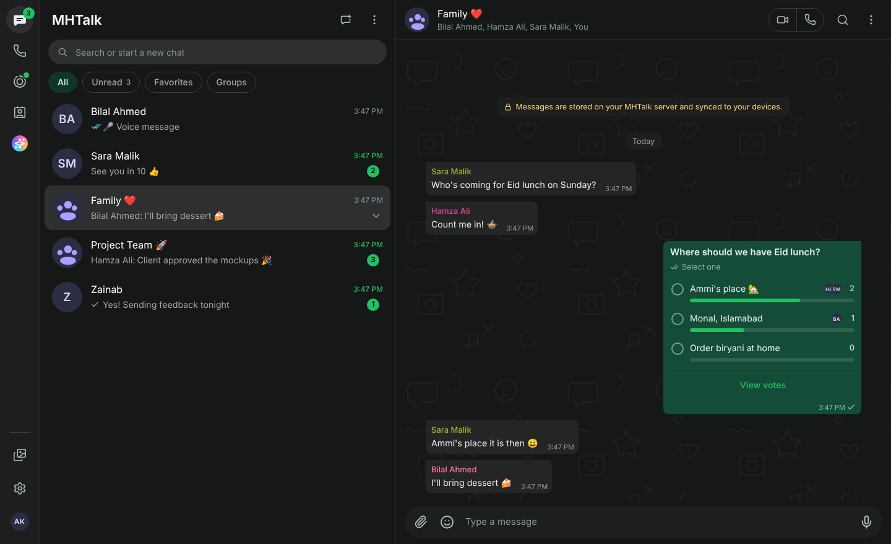
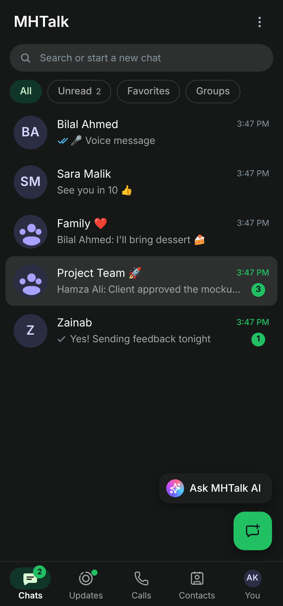
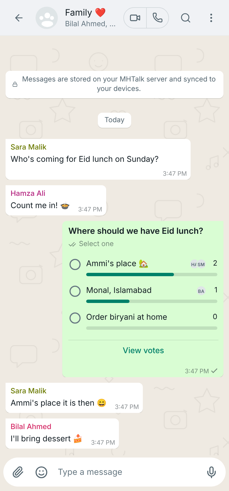
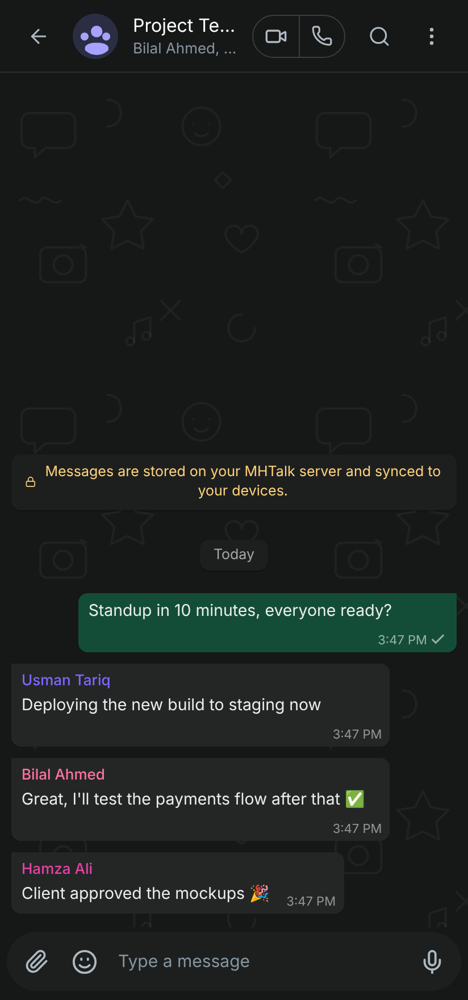
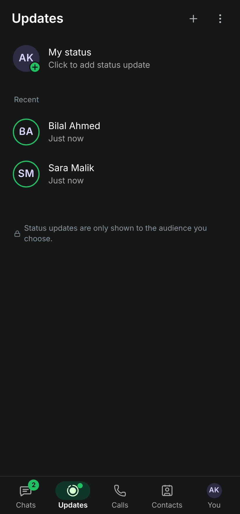
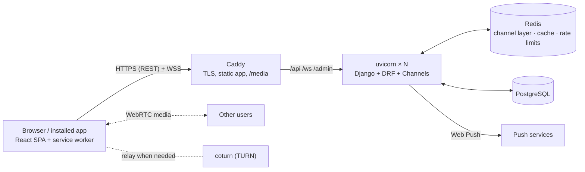
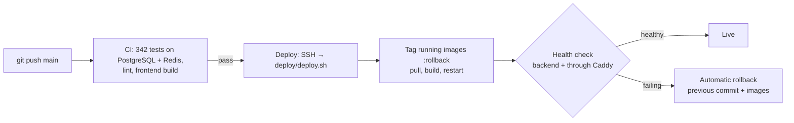

<div align="center">

# 💬 MHTalk

**A production-grade, real-time messenger modelled on WhatsApp Web and WhatsApp for Android.**

Chats, groups, voice and video calls (including group calls), status updates, polls, view once and disappearing messages, push notifications, and an installable app, built end to end with Django, Channels, PostgreSQL, Redis, React and WebRTC, tested, and deployed with Docker.




   

</div>

---

## 📊 At a glance

| | |
|---|---|
| **Scope** | ~90 REST endpoints, 4 WebSocket channels, 5 Django apps, a React single-page app and a PWA service worker |
| **Quality** | 342 automated backend tests (run on SQLite and PostgreSQL), N+1 query guards, ESLint, Playwright end-to-end runs, GitHub Actions CI |
| **Performance** (2 vCPU, measured) | 400 WebSocket connections opened in under 3 s · 2,000 requests at 50 concurrency with 0 errors · a message reached 200 open tabs in 120 ms |
| **Deployment** | One-command Docker Compose stack: Caddy (automatic HTTPS), uvicorn workers, PostgreSQL, Redis, scheduler, TURN server |

## 🎯 Engineering highlights

What this project demonstrates beyond the features themselves:

- **Real-time systems at scale.** Every event (messages, receipts, typing, presence, calls) goes through a Redis channel layer, so any number of server processes can run side by side and a message sent through one worker reaches sockets held by another. No state lives in process memory.
- **Database performance.** Every list endpoint runs a fixed number of queries no matter how much data there is, and tests fail if that ever regresses. Read receipts for hundreds of messages in a large group are written in about 7 queries instead of one pass per message. Connections go through a bounded pool.
- **Security by design.** JWT with refresh rotation and a blacklist, permission and privacy checks on every endpoint and socket, rate limiting, link previews protected against SSRF (private and loopback addresses are blocked, even after redirects), and view-once media that is never reachable by URL.
- **WebRTC calling.** One-to-one and group calls (mesh, up to 8 people) with signalling over WebSockets, screen sharing, and short-lived TURN credentials minted by the server.
- **Product polish.** A layout closely modelled on WhatsApp Web, a separate phone layout, light and dark themes, an in-browser photo editor (draw, text, shapes, blur, crop), offline support, and Web Push notifications that arrive even when the app is closed.
- **DevOps.** CI on every push, continuous deployment with a health check and **automatic rollback**, nightly backups copied off the server, production Dockerfiles, a Caddy reverse proxy with automatic HTTPS, and a step-by-step guide for a free Oracle Cloud deployment.

---

## Table of contents

- [Features](#-features)
- [Tech stack](#-tech-stack)
- [Architecture](#-architecture)
- [Quick start (local)](#-quick-start-local)
- [Configuration](#-configuration)
- [Testing](#-testing)
- [Deployment](#-deployment)
- [Scaling roadmap](#-scaling-roadmap)
- [API & real-time events](#-api--real-time-events)
- [Project structure](#-project-structure)
- [Security](#-security)
- [Roadmap](#-roadmap)
- [Author](#-author)

---

## ✨ Features

### Messaging
- One-to-one and group chats with **live delivery**, single / double / blue ticks per recipient, typing indicators, and online / last seen.
- Reply, react, edit (15 min), delete for me or for everyone (48 h), star, pin (up to 3 per chat), forward to several chats, copy, and per-member **message info**.
- **Polls** with single or multiple answers, live results and a "View votes" sheet.
- **@mentions** in groups, with a member picker and an "@" badge in the chat list.
- **Disappearing messages** (24 hours / 7 days / 90 days), with server-side expiry and a cleanup job.
- **View once** photos, videos and voice messages: served once through an authenticated endpoint, never as a public URL.
- **Link previews** fetched server-side with SSRF protection, **location sharing** with a map preview, and contact cards.
- Photos, videos, documents and audio: multi-select composer, captions, a photo editor (draw, text, shapes, blur, emoji, crop / rotate, HD or standard quality), camera capture, and a lightbox. **Voice notes** with pause-and-listen, waveform and playback speed.
- Search across all chats, starred messages, shared media / docs / links per chat and across all chats.

### Groups
- Admins, add / remove members, promote / demote, exit group.
- **Group permissions**: control who can edit group info, who can send messages, and who can add members.
- **Invite links**: share, copy, reset, and a join page that works for signed-out visitors.

### Calls
- **Voice and video calls** over WebRTC: an incoming-call card, a minimised bar, mute, camera, screen sharing, reactions, and picture-in-picture.
- **Group calls** for up to 8 people (mesh). Speaking indicators, late join from the chat banner, and a participant sheet.
- Call history with a missed-call filter, call cards in the chat, and server-issued **TURN** credentials for users on strict networks.

### Status, privacy & app
- **Status** (text / photo / video, 24 h) with audience control (my contacts, contacts except…, only share with…), viewers list and reactions.
- **Privacy**: last seen and online, profile photo, about, a read-receipts toggle, blocking (WhatsApp rules), and **delete my account**.
- **Installable app (PWA)** with an offline shell and an update prompt. **Web Push notifications** for messages and calls, even when the app is closed.
- **Light / dark / system theme**, a WhatsApp-style phone layout (bottom tabs, floating buttons, press-and-hold menus) and the desktop WhatsApp-Web layout.
- **MHTalk AI**: an assistant chat that works with free Google Gemini or Groq keys (OpenAI and Anthropic are also supported).

---

## 🛠 Tech stack

| Layer | Technology |
|---|---|
| Backend | Python 3.13, Django 6, Django REST Framework, SimpleJWT, drf-spectacular (OpenAPI) |
| Real-time | Django Channels (ASGI), Redis channel layer, uvicorn workers |
| Calls | WebRTC (mesh), STUN / TURN (coturn) |
| Database | PostgreSQL 17 (psycopg 3 with a connection pool) |
| Cache / rate limits | Redis |
| Frontend | React 19, Vite, lucide-react, a hand-written service worker (PWA + Web Push) |
| Production | Docker Compose, Caddy (automatic HTTPS), WhiteNoise, optional S3-compatible media |
| Quality | 342 backend tests (SQLite + PostgreSQL), query-count (N+1) guards, ESLint, Playwright end-to-end runs, GitHub Actions CI |

---

## 🏗 Architecture



- **One inbox socket per tab** (`/ws/chat/inbox/`) keeps the chat list, badges, presence, receipts, calls and status in sync. A room socket carries edits, reactions and typing for the open chat. Sockets reconnect with back-off, and the app re-syncs over REST.
- **Horizontally scalable.** No shared state lives in process memory: the channel layer, the call-signalling map and the rate limits are in Redis, and presence counters are in PostgreSQL. A message sent through one worker reaches sockets held by any other.
- **Bounded resources.** List endpoints run a fixed number of queries (enforced by tests). Read receipts are batch-processed, there is a PostgreSQL connection pool, and history is paginated.

More detail, including load-test numbers, is in **[docs/DEPLOYMENT.md](docs/DEPLOYMENT.md)**.

---

## 🚀 Quick start (local)

**Requirements:** Docker Desktop and Node.js 20+.

```bash
git clone https://github.com/MuhammadHaseeb3112/MHTalk.git mhtalk
cd mhtalk
cp .env.example .env              # then set SECRET_KEY and the database password

docker compose up -d --build      # Django (port 8001) + PostgreSQL + Redis
docker compose exec web python manage.py migrate
docker compose exec web python manage.py createsuperuser   # optional, for /admin

cd frontend
npm install
npm run dev                       # http://localhost:5173
```

The Vite dev server proxies `/api`, `/ws` and `/media` to the backend. Open two
browsers, register two accounts and start chatting.

| URL | What |
|---|---|
| http://localhost:5173 | The app |
| http://localhost:8001/api/docs/ | Swagger UI (interactive API docs) |
| http://localhost:8001/admin/ | Django admin |
| http://localhost:8001/api/health/ | Health check |

After pulling new code, run `docker compose up -d --build` (for new Python
packages) and `docker compose exec web python manage.py migrate`.

> **`http proxy error ... ECONNREFUSED` in the Vite terminal?** The frontend is
> running but the backend isn't. Start Docker Desktop, then run
> `docker compose up -d` in the project folder.

---

## ⚙ Configuration

All settings come from environment variables (`.env` locally, `.env.prod` in
production). Templates: [`.env.example`](.env.example) and [`deploy/env.prod.example`](deploy/env.prod.example).

| Variable | Purpose |
|---|---|
| `SECRET_KEY`, `DEBUG`, `ALLOWED_HOSTS` | Django basics |
| `DB_*` or `DATABASE_URL` | PostgreSQL (separate values, or one `postgres://` URL) |
| `REDIS_URL` | Channel layer, cache, rate limits |
| `CORS_ALLOWED_ORIGINS`, `CSRF_TRUSTED_ORIGINS` | Frontend served from another domain |
| `TURN_URLS` + `TURN_SECRET` (or `TURN_USERNAME` / `TURN_PASSWORD`) | TURN relay for calls |
| `VAPID_PUBLIC_KEY`, `VAPID_PRIVATE_KEY`, `VAPID_SUBJECT` | Web Push (`python manage.py generate_vapid_keys`) |
| `WHATSUP_AI_PROVIDER`, `WHATSUP_AI_API_KEY` | MHTalk AI (`gemini` and `groq` have free keys) |
| `USE_S3_MEDIA`, `S3_*` | Store uploads in S3 / Cloudflare R2 / Backblaze B2 |
| `THROTTLE_*` | Rate limits (auth, anonymous, user, invite links, link previews) |
| `WEB_CONCURRENCY`, `DB_POOL_MAX_SIZE` | Worker processes and DB connections per worker |

Keep `.env` files out of Git. They are already in `.gitignore`.

---

## 🧪 Testing

```bash
# backend: 342 tests, no PostgreSQL/Redis needed
DJANGO_SETTINGS_MODULE=config.settings.test python manage.py test

# frontend
cd frontend && npx eslint src pwa && npm run build
```

The suite covers messaging rules, blocking, privacy, group permissions,
invite links, polls, disappearing / view-once messages, the link-preview SSRF
guard, calls and group calls (including WebSocket signalling), push
notifications, account deletion, and **N+1 regression tests**: every list
endpoint must run the same number of queries for 2 and for 6 chats.
GitHub Actions runs the backend suite on PostgreSQL + Redis and builds the
frontend on every push ([`.github/workflows/django.yml`](.github/workflows/django.yml)).

---

## ☁ Deployment

| Guide | For |
|---|---|
| **[docs/DEPLOY_ORACLE.md](docs/DEPLOY_ORACLE.md)** | Step by step: free Oracle Cloud VM, free domain, HTTPS, TURN, backups |
| [docs/DEPLOYMENT.md](docs/DEPLOYMENT.md) | Architecture, scaling notes, other free options (Render + Neon), AWS |

Production is a single command:

```bash
cp deploy/env.prod.example .env.prod      # fill in your domain and secrets
docker compose -f docker-compose.prod.yml --env-file .env.prod --profile turn up -d --build
```

This starts Caddy (HTTPS + app), uvicorn workers, PostgreSQL, Redis, a scheduler
(disappearing messages) and coturn. Migrations run automatically on start.

**Release pipeline**



- **CI** ([`django.yml`](.github/workflows/django.yml)) runs on every push and pull request.
- **CD** ([`deploy.yml`](.github/workflows/deploy.yml) + [`deploy/deploy.sh`](deploy/deploy.sh)) deploys `main` only after CI passes, then verifies the live site.
- **Backups** ([`deploy/backup.sh`](deploy/backup.sh)): a nightly `pg_dump`, kept 14 days and copied off the server with rclone (Oracle Object Storage, Always Free).

---

## 📈 Scaling roadmap

The current deployment is deliberately simple: one free 2-core server running
everything in Docker. That is the right size for a portfolio project, and the
code is already built so that each next step is a configuration change, not a
rewrite (no state in process memory, Redis for real-time fan-out, fixed query
counts, paginated history).

| Stage | Load (rough) | What changes | Why |
|---|---|---|---|
| **Now** | up to a few thousand users | One VM: Caddy, uvicorn workers, PostgreSQL, Redis, coturn. CI/CD with rollback, nightly off-site backups. | Cheapest setup that is still safe to update and to recover. |
| **1. Scale out the app** | tens of thousands | Several identical app servers behind a load balancer; managed PostgreSQL and Redis; media on object storage behind a **CDN**. Blue-green or rolling deploys. | Web workers are stateless, so they scale horizontally; WebSockets need no sticky sessions because Redis carries every event. Serving photos from a CDN takes the heaviest traffic off the servers. |
| **2. Scale reads** | hundreds of thousands | PostgreSQL **read replicas** for chat history, search and media listings; PgBouncer; Redis Cluster for the channel layer. Canary releases to a small share of users first. | Messaging is read-heavy (history, chat lists). Writes stay on the primary; reads spread over replicas. |
| **3. Bigger calls** | groups above 8 people | An **SFU** (e.g. LiveKit or mediasoup) instead of mesh WebRTC. | In a mesh every person uploads to every other person; an SFU receives one stream each and forwards it. |
| **4. Partition data** | millions | **Shard** messages by chat id; move fan-out and push notifications to a queue (e.g. Kafka or Redis Streams) with worker pools. | One database eventually can't hold all writes. All messages of one chat stay on one shard, so a conversation never needs a cross-shard query. |

Each step is taken only when measurements show it is needed: sharding or
replicas on a single small server would add cost and failure points without
adding capacity.

---

## 📡 API & real-time events

- Interactive docs at **`/api/docs/`** (OpenAPI schema at `/api/schema/`), covering about 90 endpoints under `/api/accounts`, `/api/chat`, `/api/status`, `/api/calls` and `/api/notifications`.
- Authentication: `Authorization: Bearer <access token>` (JWT, refresh with rotation and blacklist).
- WebSockets (`?token=<access>`):

| Socket | Purpose |
|---|---|
| `/ws/chat/inbox/` | Per-user stream: new messages, receipts, typing, presence, room / profile / contacts / status / calls updates |
| `/ws/chat/<room_id>/` | Open conversation: edits, deletions, reactions, pins, poll votes, view-once state |
| `/ws/calls/inbox/` | Incoming calls |
| `/ws/calls/<room_id>/` | Call signalling (offer / answer / ICE), participants, mute and camera state |

---

## 📁 Project structure

```
apps/
  accounts/        users, profiles, contacts, privacy, account deletion
  chat/            rooms, messages, receipts, polls, mentions, disappearing,
                   view once, link previews, group permissions, invite links,
                   AI assistant, WebSocket consumers
  status/          24-hour status updates and audience rules
  calls/           1:1 and group calls, signalling, ring timeouts, history
  notifications/   Web Push subscriptions and delivery
config/            settings (base / development / production / test), ASGI, URLs, health
frontend/
  src/components/  chat list, conversation, messages, media, calls, status, settings…
  src/store/       real-time store and actions
  src/services/    sockets, notifications, theme
  pwa/             service worker + build plugin
deploy/            production Dockerfiles, Caddyfile, entrypoint, deploy + backup scripts, env template
docs/              deployment guides, screenshots
docker-compose.yml        local development
docker-compose.prod.yml   production stack
```

---

## 🔐 Security

- JWT with refresh rotation and a blacklist. Passwords use Django's hashers. Login and registration are rate-limited.
- Every endpoint and socket checks room membership and permissions. Privacy rules are enforced on the server before data leaves the API.
- View-once files are never publicly addressable. Link previews block private, loopback and link-local addresses (including after redirects).
- TURN credentials are short-lived and minted per user; no secrets ship in the JavaScript.
- Production runs behind HTTPS with secure cookies, HSTS (optional), `nosniff`, `X-Frame-Options: DENY` and a strict referrer policy.
- Messages are stored on the server (no end-to-end encryption). This is a portfolio project, not a replacement for WhatsApp.

---

## 🗺 Roadmap

- End-to-end encryption (Signal protocol)
- Communities, channels and broadcast lists
- Native mobile app (React Native) using the same API

---

## 👨‍💻 Author

**Muhammad Haseeb**: backend and full-stack developer.

I designed and built MHTalk end to end: the data model, the REST API and WebSocket protocol, the real-time and calling layers, the React interface, the test suite and the production deployment.

**Skills shown here:** Python · Django · Django REST Framework · Django Channels · WebSockets · PostgreSQL · Redis · WebRTC · React · JavaScript · REST API design · system design · query optimisation · automated testing · Docker · CI/CD · Linux servers · cloud deployment.

I'm open to backend and full-stack roles and to freelance projects.

- GitHub: [@MuhammadHaseeb3112](https://github.com/MuhammadHaseeb3112)

If you find this project useful, please ⭐ the repository.

## 📄 License

[MIT](LICENSE)
